<div align="center">

# ✚ Error Pharma

### Pharmacy Management System

**A Java desktop application for managing pharmacy operations, people and medicine inventory.**


[Overview](#overview) · [Screenshots](#interface-gallery) · [Run locally](#run-locally) · [Architecture](#system-architecture) · [OOP concepts](#object-oriented-programming)

</div>

---

## Overview

Error Pharma is an academic, role-based desktop pharmacy management system built with Java and Swing. It brings owner administration, employee operations, medicine management, customer shopping and local payment records into one application.

The UI/UX refresh introduces a unified teal-and-navy identity, native Java2D graphics, role-specific dashboard cards, scrollable layouts and interactive data tables while retaining the original Java technology stack and file-backed repositories.

| **01 · Administration** | **02 · Employee workspace** | **03 · Customer experience** |
| :--- | :--- | :--- |
| Manage owners, employees and customers. Browse medicines, orders, order items and payment records. | Manage customer records and medicine inventory; add or remove medicine records and manage the employee profile. | Register or sign in, browse medicine cards, enter quantities, record payments and manage the customer profile. |

## Interface gallery

Actual screenshots of the redesigned desktop application. The two-column cards use dotted image frames for consistent presentation on GitHub.

### 01 · Authentication and account access

<table>
  <tr>
    <td width="50%" align="center" valign="top">
      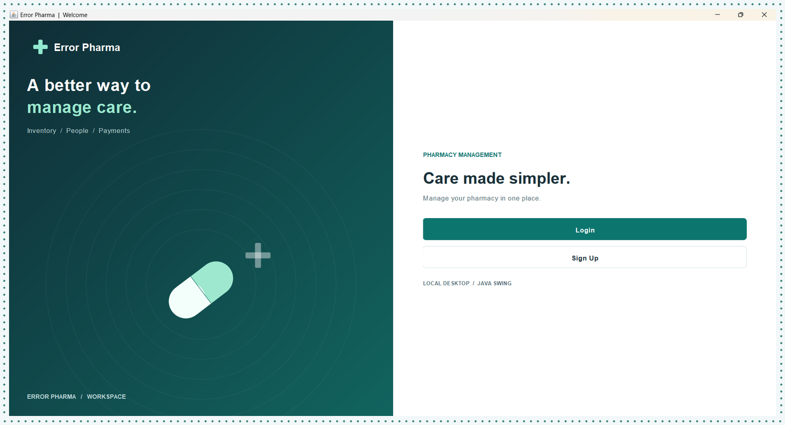<br>
      <strong>Welcome screen</strong><br>
      <sub>A clear entry point for login and registration.</sub>
    </td>
    <td width="50%" align="center" valign="top">
      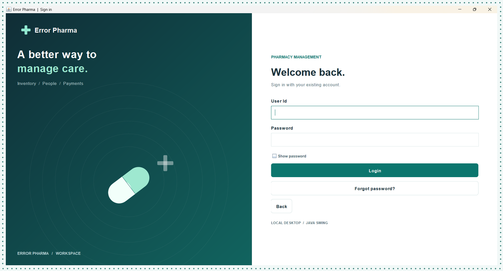<br>
      <strong>Sign in</strong><br>
      <sub>Split layout, password visibility and role-based access.</sub>
    </td>
  </tr>
  <tr>
    <td width="50%" align="center" valign="top">
      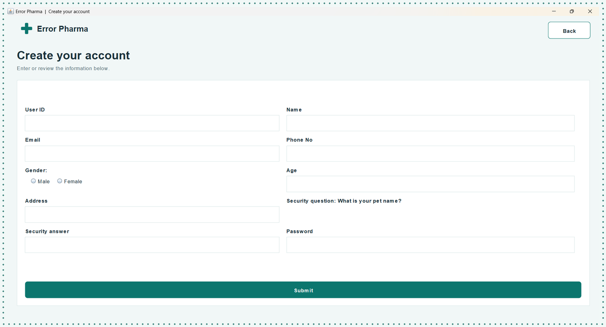<br>
      <strong>Create an account</strong><br>
      <sub>Structured customer registration form.</sub>
    </td>
    <td width="50%" align="center" valign="top">
      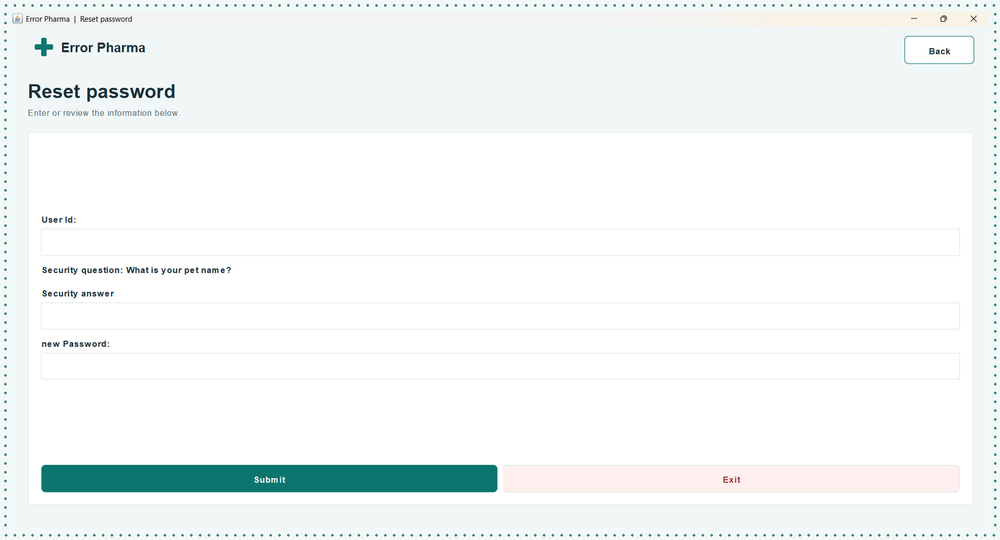<br>
      <strong>Reset password</strong><br>
      <sub>Security-question-based password recovery.</sub>
    </td>
  </tr>
</table>

### 02 · Administration and operational records

<table>
  <tr>
    <td width="50%" align="center" valign="top">
      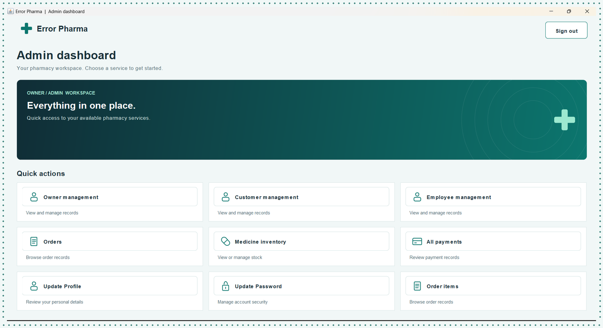<br>
      <strong>Admin dashboard</strong><br>
      <sub>Quick access to users, inventory, orders and payments.</sub>
    </td>
    <td width="50%" align="center" valign="top">
      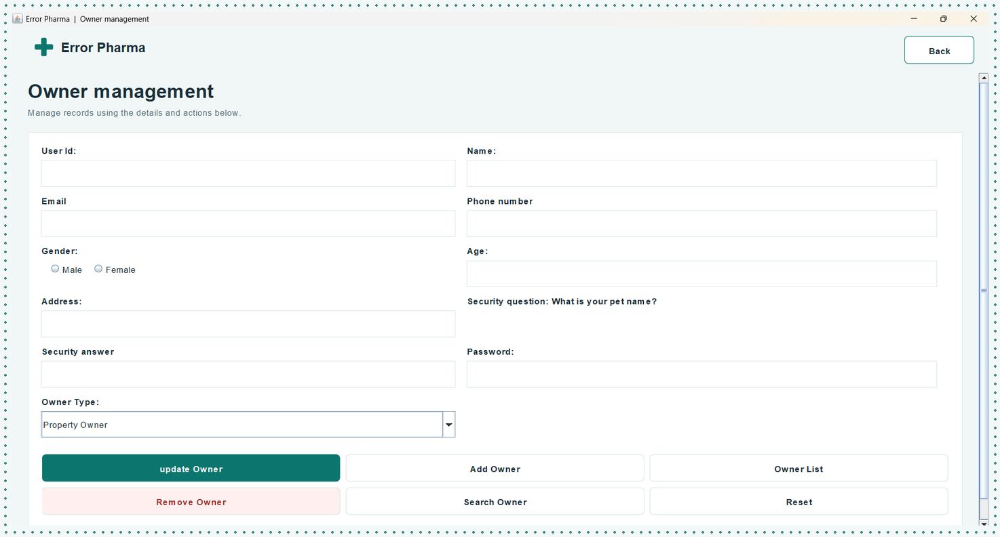<br>
      <strong>Owner management</strong><br>
      <sub>Add, update, search and remove owner records.</sub>
    </td>
  </tr>
  <tr>
    <td width="50%" align="center" valign="top">
      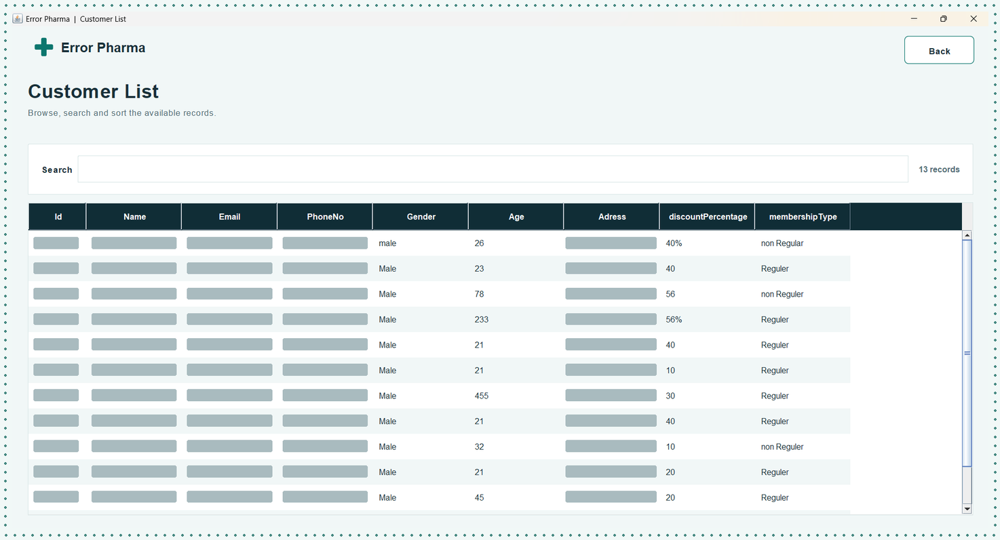<br>
      <strong>Customer directory</strong><br>
      <sub>Searchable and sortable records; identifiers masked.</sub>
    </td>
    <td width="50%" align="center" valign="top">
      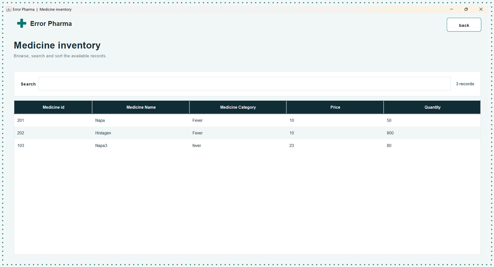<br>
      <strong>Medicine inventory</strong><br>
      <sub>Medicine categories, prices and available quantities.</sub>
    </td>
  </tr>
</table>

### 03 · Customer experience and payments

<table>
  <tr>
    <td width="50%" align="center" valign="top">
      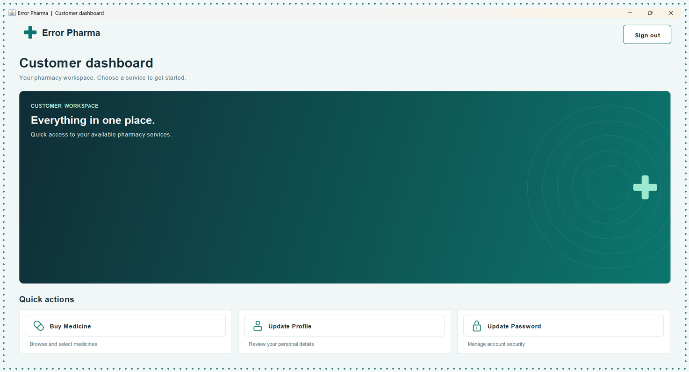<br>
      <strong>Customer dashboard</strong><br>
      <sub>Shopping and account-management shortcuts.</sub>
    </td>
    <td width="50%" align="center" valign="top">
      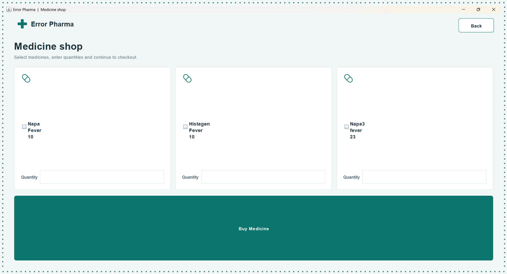<br>
      <strong>Medicine shop</strong><br>
      <sub>Select medicine cards and enter quantities.</sub>
    </td>
  </tr>
  <tr>
    <td width="50%" align="center" valign="top">
      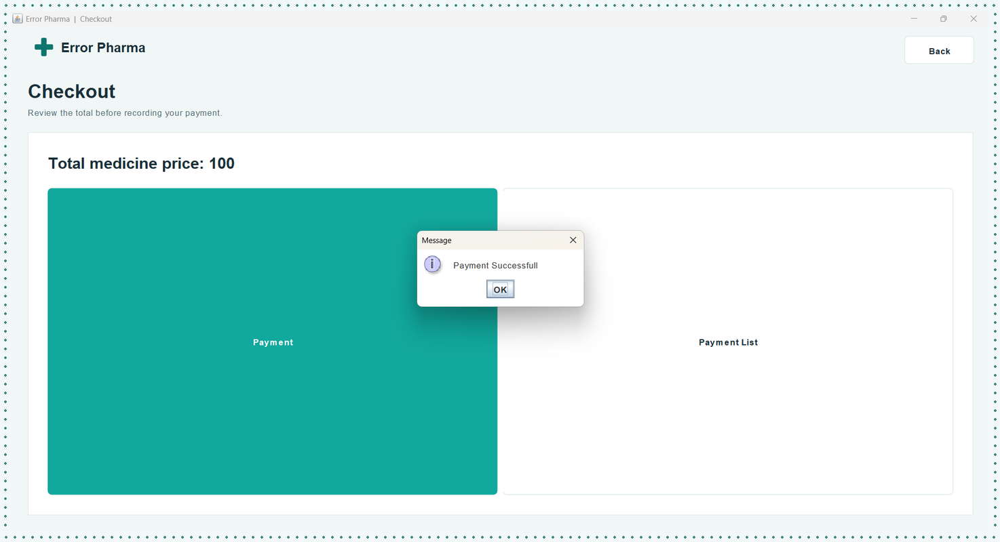<br>
      <strong>Checkout</strong><br>
      <sub>Total price and local payment confirmation.</sub>
    </td>
    <td width="50%" align="center" valign="top">
      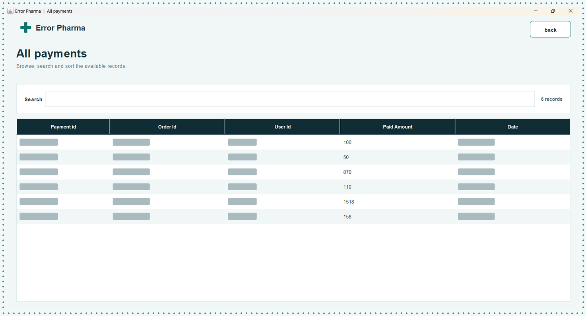<br>
      <strong>Payment records</strong><br>
      <sub>Recorded payments in a searchable table; IDs masked.</sub>
    </td>
  </tr>
</table>

> Customer and payment identifiers are masked in the public gallery. Payment confirmation represents a local record, not a real payment gateway.

---

## Run locally

**Prerequisites:** Java 8 or newer; a JDK (not just a JRE) is required to rebuild the source. No external database server or third-party UI library is required.

```bash
git clone https://github.com/arafat-rahman-lisan/Pharmacy-Management-System.git
cd Pharmacy-Management-System
```

| Platform | Run the application | Rebuild from source |
| :--- | :--- | :--- |
| Windows | Double-click `runJavaProgram.bat` | Run `buildJavaProgram.bat` |
| Linux / macOS | `sh run.sh` | `sh build.sh` |
| Any supported desktop OS | `java -jar Start.jar` | Use the platform build script |

Run from the repository root; the application reads `repositories/data/` using relative paths.

For a local demonstration, use the sample accounts in the supplied dataset (owner ID `101`, employee ID `123`, customer ID `103`). The sample passwords are stored in the local `user.txt` file. These are not production credentials. Never use real or reused passwords or personal data in a public repository.

## System architecture

The project separates the user interface, domain entities, repository contracts and file persistence. This is a layered desktop application, not a web application or a fully independent MVC implementation.

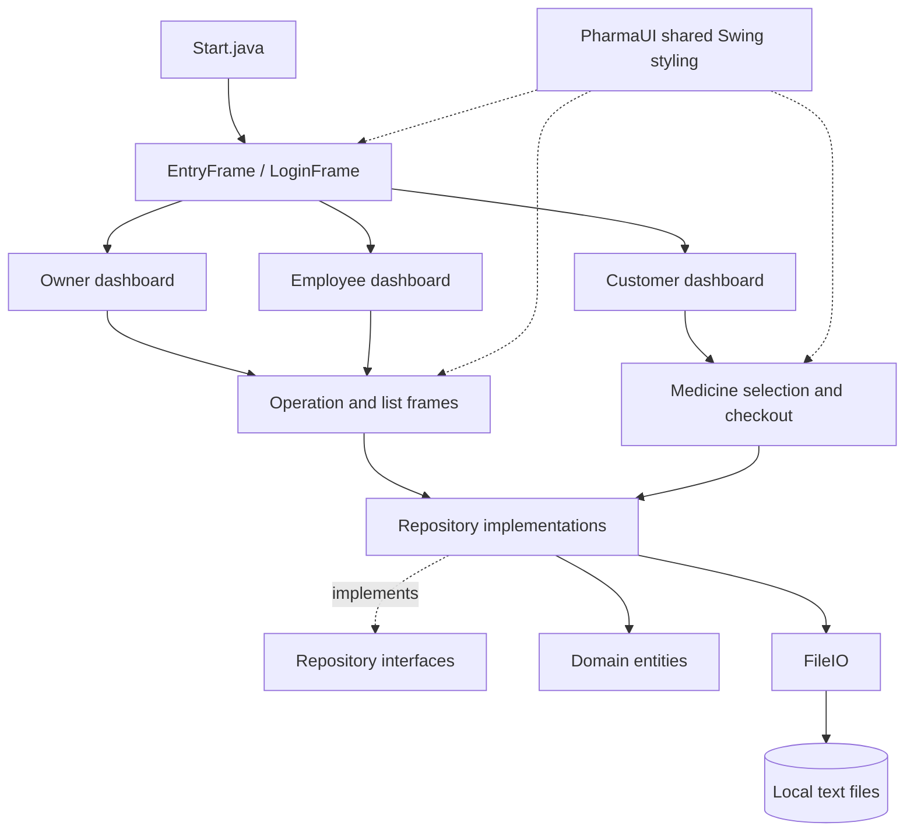

### Source structure

```text
Pharmacy-Management-System/
├── Start.java                    # Application entry point
├── Start.jar                     # Executable desktop application
├── entities/                     # User, Owner, Employee, Customer, Medicine,
│                                 # Order, OrderLine and Payment
├── interfaces/                   # Repository contracts
├── repositories/                 # Data access and record operations
│   ├── FileIO.java               # Read/write local text records
│   ├── DatabaseConnection.java   # Unused MySQL scaffold
│   └── data/                     # Local sample data files
├── frames/                       # Swing windows and event handling
│   ├── PharmaUI.java             # Shared UI styling and layouts
│   └── Picture/                  # Legacy image resources
├── docs/screenshots/             # README gallery
├── buildJavaProgram.bat          # Windows build
├── runJavaProgram.bat            # Windows launcher
├── build.sh / run.sh             # Unix build and launcher
└── README.md
```

### How core workflows are implemented

| Workflow | Classes / methods | Implementation |
| :--- | :--- | :--- |
| Authentication | `LoginFrame.performLogin()`, `UserRepo.searchUserByUserId()` | Finds a stored user, compares credentials and routes by role (1 = owner, 2 = employee, 3 = customer). |
| Inventory | `MedicineRepo.addMedicine()`, `removeMedicine()`, `updateMedicine()` | Reads medicine records, modifies the matching array entry and writes the updated data. |
| Data persistence | `FileIO.readFile()`, `writeFile()` | Uses `FileReader`, `BufferedReader` and `FileWriter`; entities convert between records and objects. |
| Medicine selection | `CustomerBuyMedicineFrame.actionPerformed()` | Reads selected checkboxes and quantities; calculates total as unit price × quantity. |
| Local checkout | `BuyFrame.actionPerformed()`, `PaymentRepo.addPayment()` | Creates a `Payment` object and records it locally. No online payment processor is used. |
| Live search | `PharmaUI.tableView()` | Uses `TableRowSorter`, `RowFilter` and `DocumentListener` for filtering, sorting and record counts. |
| UI design | `PharmaUI.install()`, `Hero.paintComponent()` | Reuses existing controls and listeners while installing layouts, colors, custom drawing and shared styling. |

---

## Technology stack

| Technology | Where it is used | Why it is used |
| :--- | :--- | :--- |
| Java (JDK 8+) | Entire codebase | Object-oriented application logic, portability and standard libraries. |
| Java Swing (`javax.swing`) | `frames/`, `PharmaUI.java` | Native desktop components: forms, buttons, tables, dialogs and layouts. |
| AWT / Java2D (`java.awt`) | `PharmaUI.java` | Custom gradients, vector-style icons, antialiasing and graphics painting. |
| Swing events | `ActionListener`, `DocumentListener` | Handles button actions, keyboard submission and live text filtering. |
| Java I/O (`java.io`) | `FileIO.java`, repositories | Local persistence without a database service. |
| Java arrays and collections | Repositories, UI helper | Stores domain records and dynamically collects UI controls. |
| Git / GitHub | Version control and documentation | Source history, collaboration and portfolio presentation. |
| JAR / batch / shell scripts | `Start.jar`, build and run scripts | Packaging, reproducible compilation and convenient launch. |

**Database note:** `DatabaseConnection.java` contains an original JDBC/MySQL scaffold. The running application uses text-file repositories, not an active MySQL database.

## Object-oriented programming

The implementation demonstrates the four core OOP concepts, alongside constructors, composition and event-driven design. The following examples refer to classes and methods actually present in the source.

### 01 · Encapsulation

`entities/Medicine.java` uses private fields for medicine information and public accessors. `User.java` uses protected fields with public accessors so derived account classes can reuse shared properties.

```java
// Abridged from Medicine.java
private int pricePerUnit, availableQuantity;

public int getPricePerUnit() {
    return this.pricePerUnit;
}
```

**Why:** groups state and related methods in a domain object and provides controlled access points. The current setters do not enforce all business validation rules; that remains an improvement opportunity.

### 02 · Inheritance

`Owner`, `Employee` and `Customer` extend the common `User` class and add role-specific attributes. Their constructors call `super(...)` to initialize inherited information.

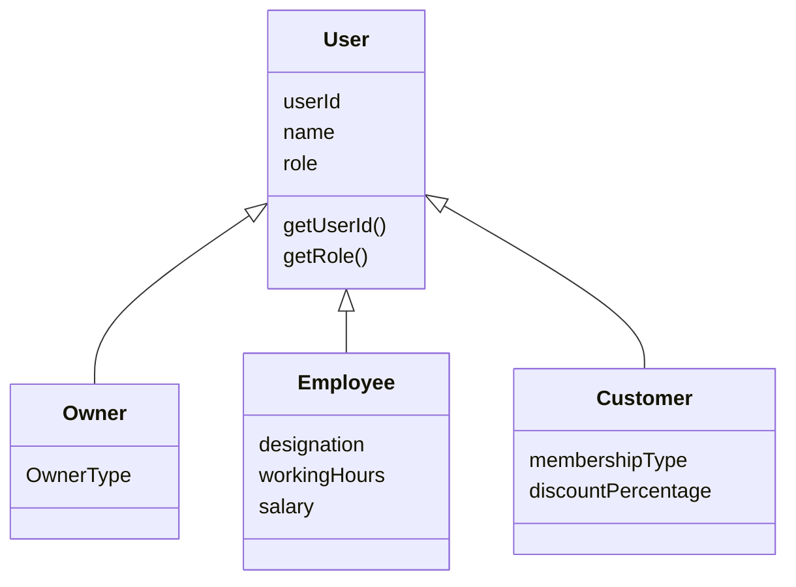

```java
public class Customer extends User {
    private String membershipType, discountPercentage;
    // Constructors and accessors omitted.
}
```

**Why:** avoids repeating common account properties and makes role-specific data easier to maintain. Swing frames also extend `JFrame` to reuse window behavior.

### 03 · Abstraction

Repository interfaces specify what record operations must be supported without exposing the text-file implementation to the contract itself.

```java
// Abridged from IMedicineRepo.java
public interface IMedicineRepo {
    void addMedicine(Medicine s);
    void removeMedicine(String id);
    void updateMedicine(Medicine c);
    Medicine searchMedicineByMedicineId(String id);
    Medicine[] getAllMedicine();
}
```

`MedicineRepo implements IMedicineRepo` and supplies those operations. Other domain repositories follow a similar interface structure.

**Why:** documents a consistent data-access contract and makes alternative implementations possible. Many existing frames still instantiate concrete repositories directly, so dependency inversion is not fully implemented.

### 04 · Polymorphism

The shared UI uses method overriding in Swing. For example, `PharmaUI.Hero` extends `JPanel` and overrides `paintComponent(Graphics g)` to supply custom gradient and capsule artwork.

```java
// Abridged from PharmaUI.java
@Override
protected void paintComponent(Graphics g) {
    super.paintComponent(g);
    // Custom Java2D drawing follows.
}
```

**Why:** Swing can call the same painting method on different component types and execute each component's specific implementation. The frames also implement `ActionListener.actionPerformed(ActionEvent)` with different event-handling behavior. This is runtime polymorphism, not simply role-based `if/else` routing.

### Additional OOP and design techniques

| Concept | Actual implementation | Purpose |
| :--- | :--- | :--- |
| Constructors and overloading | Default and parameterized constructors in `User`, `Medicine` and other entities | Create objects with different initialization options. |
| `super` keyword | Role entity constructors call the parent constructor | Initialize shared user state before role-specific fields. |
| Composition / has-a relationship | Frames contain Swing buttons, fields, panels and repository references | Build complex windows from reusable components. |
| Interface implementation | `MedicineRepo implements IMedicineRepo`; frames implement `ActionListener` | Define capabilities and standardize methods. |
| Object serialization to text | `Medicine.toStringMedicine()` and `formMedicine()` | Convert between domain objects and stored text records (not Java native object serialization). |
| Separation of concerns | `entities`, `interfaces`, `repositories`, `frames` | Keep domain data, contracts, persistence and presentation in distinct packages. |

---

## Limitations and future improvements

This is an educational desktop prototype, not a production pharmacy system. The original local data format stores plaintext credentials, repositories use fixed-capacity arrays, and checkout records payments without a real payment gateway or a complete transactional stock/order workflow. A production version would require password hashing, stronger input validation, reliable transaction IDs, transactional inventory updates and a proper database. Use synthetic records only for public demonstrations.

## Author

**Arafat Rahman Lisan**  
[GitHub profile](https://github.com/arafat-rahman-lisan)

<div align="center">

**Error Pharma** · Java desktop application · OOP project

</div>
